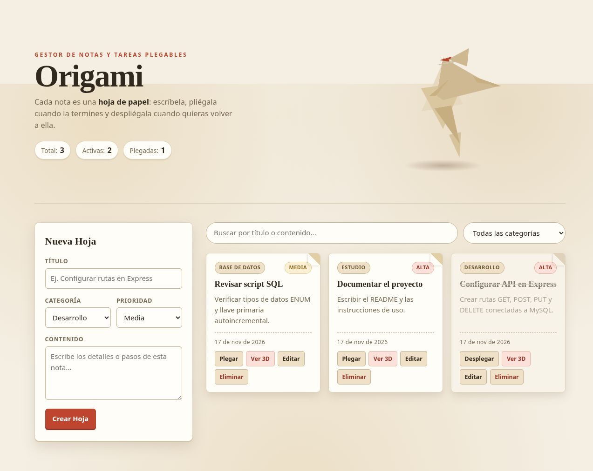
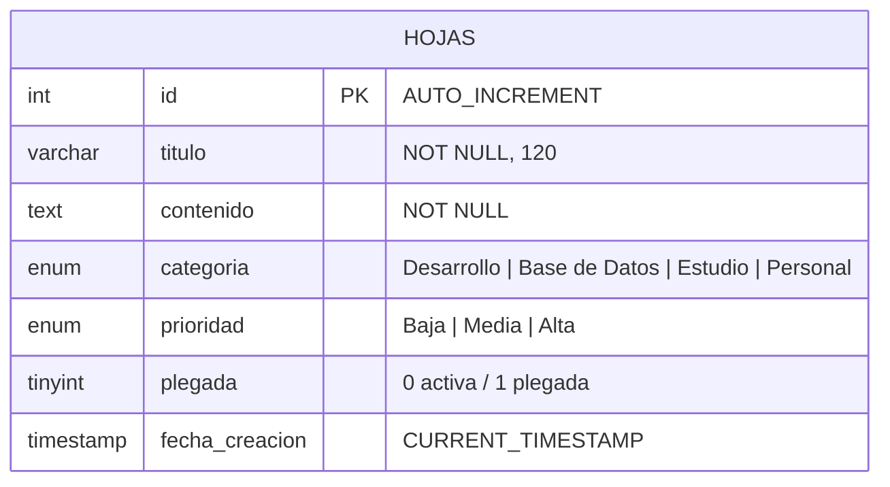

# Origami — Gestor de Notas y Tareas Plegables

[](https://github.com/macaqui/origami/actions/workflows/ci.yml)

Proyecto final de la **Técnica en Desarrollo de Software (SENA)**. Aplicación web
Full-Stack para crear, organizar, editar, filtrar y *plegar* (completar) notas
técnicas por categoría y prioridad.

> **¿Por qué "Origami"?** Cada nota es una *hoja*. Cuando la terminas, la **pliegas**:
> la tarjeta queda atenuada y tachada, pero nunca se pierde — puedes **desplegarla**
> otra vez en cualquier momento. El gestor cuenta con un formulario lateral, un
> buscador en vivo y filtros por categoría.



---

## Tecnologías utilizadas

| Capa | Tecnología |
| --- | --- |
| Frontend | React 19 + Vite 8 + CSS3 (tema oscuro) |
| Backend | Node.js + Express 4 |
| Base de datos | MySQL 8 / MariaDB (driver `mysql2/promise`, pool de conexiones) |
| Pruebas | Vitest + Supertest |
| Otros | `dotenv`, `cors`, `oxlint` |

---

## Estructura del proyecto

```
origami/
├── client/                     # Frontend (React + Vite)
│   ├── public/
│   ├── src/
│   │   ├── components/
│   │   │   ├── HojaCard.jsx    # Tarjeta de una hoja (plegar / editar / eliminar)
│   │   │   └── HojaForm.jsx    # Formulario de creación y edición
│   │   ├── services/
│   │   │   └── hojasService.js # Capa de acceso a la API REST
│   │   ├── App.css
│   │   ├── App.jsx             # Estado global, filtros y CRUD
│   │   ├── index.css
│   │   └── main.jsx
│   ├── index.html
│   ├── vite.config.js
│   └── package.json
├── server/                     # Backend (Node.js + Express + MySQL)
│   ├── src/
│   │   ├── config/db.js        # Pool de conexiones a MySQL
│   │   ├── controllers/hojasController.js
│   │   ├── routes/hojasRoutes.js
│   │   ├── app.js              # Definición de la app Express (middlewares y rutas)
│   │   └── index.js            # Arranque del servidor
│   ├── tests/hojas.test.js     # Pruebas de integración (Vitest + Supertest)
│   ├── database.sql            # Esquema, datos de ejemplo y usuario de la app
│   ├── .env.example
│   └── package.json
├── docker-compose.yml          # MySQL listo para usar (opcional)
├── docs/
│   ├── captura-app.jpeg        # Captura de la interfaz
│   └── despliegue.md           # Cómo publicarlo online (3 opciones)
├── .github/workflows/ci.yml    # Integración continua (pruebas + build automáticos)
├── iniciar-windows.bat         # Arranque automático en Windows
├── preparar-base-de-datos.bat  # Crea la base en MySQL (solo la primera vez)
├── .gitattributes              # Fuerza saltos de línea CRLF en los .bat
├── LICENSE
├── .gitignore
└── README.md
```

---

## Requisitos previos

- **Node.js** 20 o superior y **npm**
- **MySQL** 8.x o **MariaDB** 10.x en ejecución (o Docker, ver abajo)

---

## Instalación y ejecución

### Opción A — Con Docker (la más rápida)

```bash
docker compose up -d          # levanta MySQL y carga database.sql automáticamente
cd server && cp .env.example .env && npm install && npm run dev
cd ../client && cp .env.example .env && npm install && npm run dev
```

### Opción B — MySQL/MariaDB local

**1. Base de datos.** Importa el script (crea la base `origami_db`, la tabla
`hojas`, 3 registros de ejemplo y el usuario de aplicación `origami`):

```bash
mysql -u root -p < server/database.sql
```

**2. Backend.**

```bash
cd server
cp .env.example .env      # ajusta usuario y contraseña de MySQL si hace falta
npm install
npm run dev               # http://localhost:3001
```

**3. Frontend.**

```bash
cd client
cp .env.example .env      # define VITE_API_URL (URL del backend)
npm install
npm run dev               # http://localhost:5173
```

### Opción C — Windows (arranque automático)

Windows no tiene el comando `cp` y las rutas usan `\`, así que el proyecto
incluye dos scripts que se ejecutan con doble clic:

| Script | Cuándo | Qué hace |
| --- | --- | --- |
| `preparar-base-de-datos.bat` | **Solo la primera vez** | Importa `server\database.sql` en MySQL (puede pedirte la contraseña de `root`; si no tiene, pulsa Enter) |
| `iniciar-windows.bat` | **Cada vez** | Crea el `.env`, instala las dependencias, compila la interfaz y arranca el servidor |

Luego abre `http://localhost:3001`: la interfaz y la API quedan en el mismo
enlace. Si prefieres el paso a paso manual:

```bat
mysql -u root -p < server\database.sql
cd server
npm ci
copy .env.example .env
cd ..\client
npm ci
npm run build
cd ..\server
npm start
```

---

## API REST

Base: `http://localhost:3001/api`

| Método | Endpoint | Descripción | Respuestas |
| --- | --- | --- | --- |
| `GET` | `/health` | Verificación de estado del servicio | `200` |
| `GET` | `/hojas` | Lista las hojas (activas primero, luego por fecha) | `200`, `500` |
| `GET` | `/hojas/:id` | Obtiene una hoja por su id | `200`, `404`, `500` |
| `POST` | `/hojas` | Crea una hoja | `201`, `400`, `500` |
| `PUT` | `/hojas/:id` | Actualiza contenido, categoría, prioridad o estado plegado | `200`, `400`, `404`, `500` |
| `DELETE` | `/hojas/:id` | Elimina una hoja | `200`, `404`, `500` |

**Ejemplo — crear una hoja:**

```bash
curl -X POST http://localhost:3001/api/hojas \
  -H "Content-Type: application/json" \
  -d '{"titulo":"Repasar consultas JOIN","contenido":"Practicar INNER y LEFT JOIN.","categoria":"Base de Datos","prioridad":"Alta"}'
```

**Ejemplo — plegar la hoja con id 1:**

```bash
curl -X PUT http://localhost:3001/api/hojas/1 \
  -H "Content-Type: application/json" \
  -d '{"titulo":"Configurar API en Express","contenido":"Crear rutas GET, POST, PUT y DELETE conectadas a MySQL.","categoria":"Desarrollo","prioridad":"Alta","plegada":true}'
```

> Si en el `PUT` se omite el campo `plegada`, la hoja **conserva** su estado
> actual (el SQL usa `COALESCE`), de modo que editar el texto nunca despliega
> una hoja por accidente.

---

## Modelo de datos

Tabla `hojas`:

| Campo | Tipo | Notas |
| --- | --- | --- |
| `id` | `INT AUTO_INCREMENT` | Llave primaria |
| `titulo` | `VARCHAR(120)` | Obligatorio |
| `contenido` | `TEXT` | Obligatorio |
| `categoria` | `ENUM('Desarrollo','Base de Datos','Estudio','Personal')` | Por defecto `Desarrollo` |
| `prioridad` | `ENUM('Baja','Media','Alta')` | Por defecto `Media` |
| `plegada` | `TINYINT(1)` | `0` activa / `1` plegada |
| `fecha_creacion` | `TIMESTAMP` | `CURRENT_TIMESTAMP` |

**Diagrama entidad-relación:**



La aplicación usa un usuario dedicado (`origami`) con permisos solo sobre
`origami_db`, en lugar de conectarse como `root`.

---

## Pruebas

### Pruebas automatizadas

Con la base de datos en ejecución:

```bash
cd server
npm test
```

Cubren el ciclo completo del CRUD (crear, listar, consultar, actualizar,
plegar, eliminar), la validación de datos, los códigos `404` y el manejador de
rutas inexistentes.

> **Última ejecución:** 11/11 pruebas aprobadas, contra MariaDB 13.0.2.
> El CRUD también se verificó de extremo a extremo desde la interfaz
> (crear desde el formulario y ver la tarjeta nueva en la lista).

### Integración continua

El flujo [`.github/workflows/ci.yml`](.github/workflows/ci.yml) se ejecuta en cada
`push` y `pull_request`: levanta un MySQL 8.4, carga `database.sql`, corre las
pruebas del backend y, en paralelo, revisa el lint y compila el frontend. El
estado se ve en el badge de la portada.

### Matriz de pruebas (evidencia QA)

| ID | Módulo | Caso de prueba | Entrada / Acción | Resultado esperado | Estado |
| --- | --- | --- | --- | --- | --- |
| CP-01 | API / BD | Listar registros iniciales | `GET /api/hojas` | `200 OK` con arreglo JSON de las 3 hojas iniciales | Aprobado |
| CP-02 | API / Validación | Crear hoja con campos vacíos | `POST /api/hojas` con `{"titulo": ""}` | `400 Bad Request`, bloquea la inserción | Aprobado |
| CP-03 | API / CRUD | Crear hoja válida | `POST /api/hojas` con título, contenido, categoría y prioridad | `201 Created` y persistencia en MySQL | Aprobado |
| CP-04 | API / CRUD | Plegar (completar) hoja | `PUT /api/hojas/1` con `"plegada": true` | `200 OK` y `plegada = 1` | Aprobado |
| CP-05 | API / Errores | Eliminar ID inexistente | `DELETE /api/hojas/9999` | `404 Not Found` con mensaje controlado | Aprobado |
| CP-06 | Frontend React | Filtro combinado en vivo | Seleccionar categoría + escribir en el buscador | Filtra tarjetas sin recargar la página | Aprobado |
| CP-07 | API / CRUD | Consultar hoja por id | `GET /api/hojas/4` | `200 OK` con la hoja solicitada | Aprobado |
| CP-08 | API / CRUD | Eliminar hoja existente | `DELETE /api/hojas/4` | `200 OK` y fila eliminada de la base | Aprobado |

---

## Despliegue

Origami puede publicarse como **un solo servicio**: Express sirve la interfaz
compilada (`client/dist`) y la API desde el **mismo origen**, así que no hay que
configurar CORS ni dos direcciones distintas.

```bash
cd client && npm run build     # genera client/dist
cd ../server && npm start      # sirve interfaz + API en http://localhost:3001
```

Para dar una **URL pública** sin desplegar nada (útil para una demo), se compila
y se abre un túnel con `cloudflared`. Para un despliegue **permanente** en la
nube hay una guía paso a paso con Render + MySQL gratuito:

📄 **[`docs/despliegue.md`](docs/despliegue.md)** — las tres opciones, con los
comandos exactos y una tabla de solución de problemas.

---

## Decisiones de diseño

- **Separación en capas**: `routes → controllers → config/db` en el backend y
  `components` + `services` en el frontend, para que la lógica de acceso a datos
  no se mezcle con la interfaz.
- **Consultas parametrizadas** (`?`) en las cuatro operaciones → protección
  contra inyección SQL.
- **Validación en el servidor**, no solo en el formulario.
- **Usuario de base de datos dedicado** (`origami`) en lugar de `root`.
- **Credenciales fuera del repositorio**: `.env` está en `.gitignore` y solo se
  versiona `.env.example`.
- **URL de la API configurable**: el frontend lee `VITE_API_URL` desde
  `client/.env` (plantilla en `client/.env.example`), así que cambiar el puerto o
  el dominio del backend no obliga a tocar el código.

---

## Autor

Proyecto desarrollado como entrega final para el **SENA — Técnica en Desarrollo de Software**.

Distribuido bajo licencia **MIT** (ver `LICENSE`).
